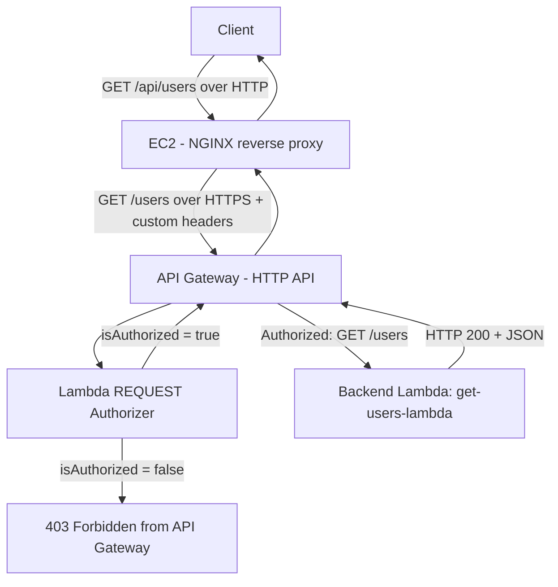

# NGINX Custom Headers & API Gateway Security

> AWS infrastructure imported into Terraform — EC2, NGINX, HTTP API, Lambda Authorizer, and IAM.

## Overview

This project demonstrates an HTTP request forwarding architecture in which **NGINX** acts as a reverse proxy and injects internal request headers, while **Amazon API Gateway**, using a **Lambda REQUEST authorizer**, makes the authorization decision before invoking a backend Lambda function.

The existing AWS infrastructure was originally configured manually and then imported into Terraform. The final recorded `terraform plan` reported **No changes** for the Terraform-managed configuration. This is an import project, not evidence that the API test cases have all passed.

## Architecture



NGINX adds these upstream headers:

| Header | Meaning | Example (non-secret) |
| --- | --- | --- |
| `X-Environment` | Environment identifier | `dev` |
| `X-Student-ID` | Student identifier | `STU12345` |
| `X-Internal-Token` | Shared secret checked by the authorizer | **Do not publish the value** |

> **Security boundary:** NGINX forwards and injects headers; it does not make the authorization decision. API Gateway enforces the Lambda authorizer's allow/deny result. The public API Gateway URL can also be called directly, so the internal token is a shared secret, not proof that traffic traversed NGINX. The current NGINX public HTTP endpoint does not encrypt traffic between the client and EC2; HTTPS is recommended for production.

## Deployed AWS Resources

- **Region:** `eu-central-1` (Frankfurt)
- **API Gateway HTTP API ID:** `bywr2o2c5a`
- **API route:** `GET /users`
- **Stage:** `$default` (auto deploy enabled)
- **API Gateway Authorizer ID:** `sppyrk`
- **Integration ID:** `m6koeh3`
- **Backend Lambda:** `get-users-lambda`
- **Authorizer Lambda:** `custom-header-authorizer`
- **EC2 Instance ID:** `i-0e5045e0f788d4ba7`
- **Security Group ID:** `sg-046b54045a7d254f6`

The EC2 instance currently runs **Ubuntu**, although the assignment specifies **Amazon Linux**. This gap should be addressed or explicitly documented at submission time. Importing a running instance does not change its operating system.

### Terraform import inventory (17 resources)

| # | Terraform resource address | AWS object |
| --- | --- | --- |
| 1 | `aws_apigatewayv2_api.student_api` | HTTP API |
| 2 | `aws_apigatewayv2_stage.default_stage` | `$default` stage |
| 3 | `aws_apigatewayv2_route.users_route` | `GET /users` route |
| 4 | `aws_apigatewayv2_integration.users_integration` | Lambda proxy integration |
| 5 | `aws_apigatewayv2_authorizer.header_authorizer` | Lambda request authorizer |
| 6 | `aws_lambda_function.users` | Backend Lambda |
| 7 | `aws_lambda_function.authorizer` | Authorizer Lambda |
| 8 | `aws_lambda_permission.users_api_invoke` | Backend invocation permission |
| 9 | `aws_lambda_permission.authorizer_api_invoke` | Authorizer invocation permission |
| 10 | `aws_iam_role.users_role` | Backend execution role |
| 11 | `aws_iam_role.authorizer_role` | Authorizer execution role |
| 12 | `aws_iam_policy.users_policy` | Backend logging policy |
| 13 | `aws_iam_policy.authorizer_policy` | Authorizer logging policy |
| 14 | `aws_iam_role_policy_attachment.users_basic_execution` | Backend policy attachment |
| 15 | `aws_iam_role_policy_attachment.authorizer_basic_execution` | Authorizer policy attachment |
| 16 | `aws_instance.nginx_server` | EC2 instance |
| 17 | `aws_security_group.nginx_sg` | EC2 Security Group |

## Project Files

```text
nginx-terraform-import/
├── provider.tf
├── api-gateway.tf
├── ec2.tf
├── security-group.tf
├── lambda.tf
├── lambda-permissions.tf
├── iam.tf
├── iam-managed-policies.tf
├── iam-policies.tf
├── .terraform.lock.hcl
├── .gitignore
└── README.md
```

**Recommended additions for a complete assignment submission** (not yet included in the observed folder listing): `nginx/api-proxy.conf` with a token placeholder, Lambda source files, an architecture image if required, and test screenshots. The current `.tf` files import/manage AWS resources; Terraform does not automatically retrieve NGINX files from inside the EC2 instance or recover Lambda source code into the repository.

## Prerequisites

- Terraform CLI and AWS CLI installed
- AWS credentials with appropriate read/import permissions
- A configured AWS profile or environment credentials targeting the correct AWS account
- PowerShell for the commands below

Verify identity and region:

```powershell
aws sts get-caller-identity
aws configure get region
```

## Terraform Initialization & Validation

From the project directory:

```powershell
terraform init
terraform fmt -recursive
terraform validate
terraform state list
terraform plan
```

The last recorded plan after the 17 imports reported:

```text
No changes. Your infrastructure matches the configuration.
```

This confirms no changes were proposed **for the managed attributes at that time**. Some Lambda attributes were intentionally placed in `ignore_changes` during import, so a no-change plan does not verify that all Lambda code and environment variables are represented in version-controlled Terraform configuration.

## Importing the Existing Infrastructure

> These are **reference commands from the completed import process**, not commands to rerun if an address already exists in Terraform state. Reimporting a managed address produces a `Resource already managed by Terraform` error.

First define the corresponding `resource` blocks in `.tf` files and run `terraform init`. Verify the AWS account and region before importing.

### API Gateway

```powershell
terraform import aws_apigatewayv2_api.student_api bywr2o2c5a
terraform import aws_apigatewayv2_authorizer.header_authorizer 'bywr2o2c5a/sppyrk'
terraform import aws_apigatewayv2_integration.users_integration 'bywr2o2c5a/m6koeh3'
terraform import aws_apigatewayv2_route.users_route 'bywr2o2c5a/j9iig66'
terraform import aws_apigatewayv2_stage.default_stage 'bywr2o2c5a/$default'
```

### Lambda Functions

```powershell
terraform import aws_lambda_function.users get-users-lambda
terraform import aws_lambda_function.authorizer custom-header-authorizer
```

### IAM Roles

```powershell
terraform import aws_iam_role.users_role get-users-lambda-role-6qk8ocfp
terraform import aws_iam_role.authorizer_role custom-header-authorizer-role-jfuy8y00
```

### IAM Policies & Attachments

```powershell
terraform import aws_iam_policy.users_policy 'arn:aws:iam::232812966651:policy/service-role/AWSLambdaBasicExecutionRole-e29ab897-e2cb-41d6-9709-c95b8f9601fe'
terraform import aws_iam_policy.authorizer_policy 'arn:aws:iam::232812966651:policy/service-role/AWSLambdaBasicExecutionRole-d66bea47-d25b-4c0e-a805-5b9841e79e34'

terraform import aws_iam_role_policy_attachment.users_basic_execution 'get-users-lambda-role-6qk8ocfp/arn:aws:iam::232812966651:policy/service-role/AWSLambdaBasicExecutionRole-e29ab897-e2cb-41d6-9709-c95b8f9601fe'
terraform import aws_iam_role_policy_attachment.authorizer_basic_execution 'custom-header-authorizer-role-jfuy8y00/arn:aws:iam::232812966651:policy/service-role/AWSLambdaBasicExecutionRole-d66bea47-d25b-4c0e-a805-5b9841e79e34'
```

### Lambda Invocation Permissions

```powershell
terraform import aws_lambda_permission.users_api_invoke 'get-users-lambda/30062871-729e-542a-b426-70ab708058d4'
terraform import aws_lambda_permission.authorizer_api_invoke 'custom-header-authorizer/d4663602-373d-5712-9bc0-2fc4acd38328'
```

### EC2 & Security Group

```powershell
terraform import aws_instance.nginx_server i-0e5045e0f788d4ba7
terraform import aws_security_group.nginx_sg sg-046b54045a7d254f6
```

After importing, run:

```powershell
terraform state list
terraform plan
```

**Do not run `terraform apply` just to finish an import.** Resolve configuration drift first. The `prevent_destroy` lifecycle setting was used to protect important resources from accidental replacement.

## API Endpoints

- **Direct API Gateway:** `https://bywr2o2c5a.execute-api.eu-central-1.amazonaws.com/users`
- **Via NGINX:** `http://<EC2_PUBLIC_IP>/api/users`

With the proposed trailing-slash `proxy_pass`, NGINX rewrites `/api/users` to `/users` upstream. The reverse proxy should override the internal headers with trusted configured values, not blindly accept client-supplied claims.

## Authorization Rules

| Condition | Expected behavior |
| --- | --- |
| All three headers valid | Allow backend invocation, expected HTTP 200 |
| `X-Environment` is not `dev` | Deny, expected HTTP 403 |
| `X-Student-ID` missing | Deny, expected HTTP 403 |
| `X-Internal-Token` invalid | Deny, expected HTTP 403 |
| Undefined API route | Expected HTTP 404 |

For an HTTP API Lambda authorizer configured with payload format `2.0` and simple responses, the Lambda returns `isAuthorized: true` or `false`. API Gateway applies that decision. Missing identity sources can otherwise lead to a 401 response before Lambda invocation; the configuration in this project uses a stable route-based identity source and disables caching during tests.

## Testing

Test the end-to-end positive path through NGINX (from EC2 or replace with the actual public IP):

```bash
curl -i http://localhost/api/users
```

For negative authorization tests, call the **API Gateway endpoint directly** and set the headers in Postman or `curl`. NGINX overwrites these headers with configured values, so sending bad client-side headers *through NGINX* will not reliably produce negative tests. Use a local variable for the secret rather than typing it into command history or placing it in the README.

```powershell
$api = 'https://bywr2o2c5a.execute-api.eu-central-1.amazonaws.com/users'
# Obtain the rotated token securely and use it locally; do not commit it.
# Example: $token = Read-Host 'Token'

# Valid (replace the placeholder with your local secret variable)
curl.exe -i $api -H 'X-Environment: dev' -H 'X-Student-ID: STU12345' -H "X-Internal-Token: $token"

# Invalid environment
curl.exe -i $api -H 'X-Environment: prod' -H 'X-Student-ID: STU12345' -H "X-Internal-Token: $token"

# Missing student ID
curl.exe -i $api -H 'X-Environment: dev' -H "X-Internal-Token: $token"

# Invalid token
curl.exe -i $api -H 'X-Environment: dev' -H 'X-Student-ID: STU12345' -H 'X-Internal-Token: invalid-token'

# Undefined route
curl.exe -i 'https://bywr2o2c5a.execute-api.eu-central-1.amazonaws.com/unknown'
```

Capture screenshots for each test and record actual status codes. **Do not describe expected outcomes as observed test results until verified.** Mask the internal token and any credentials in screenshots.

| Test | Expected HTTP status | Observed status |
| --- | --- | --- |
| NGINX + valid headers | 200 | Not recorded in this repository |
| Invalid environment | 403 | Not recorded in this repository |
| Missing student ID | 403 | Not recorded in this repository |
| Invalid token | 403 | Not recorded in this repository |
| Undefined route | 404 | Not recorded in this repository |

## Security & Submission Notes

1. **Rotate the internal token.** An earlier CLI output exposed its value; replace it both in the authorizer configuration and NGINX, and never commit it.
2. **Never commit Terraform state** (`terraform.tfstate`, backups), credentials, `.tfvars` containing secrets, SSH keys, or `.terraform/`.
3. **Commit `.terraform.lock.hcl`** to keep provider versions consistent across environments.
4. **Review SSH ingress:** the imported Security Group was observed to permit port 22 from `0.0.0.0/0`; restrict it to a trusted IP/CIDR after the import exercise.
5. **HTTPS for clients:** the assignment specifies HTTP port 80, but a real deployment should terminate TLS before sensitive traffic reaches NGINX.
6. **System difference:** the current EC2 is Ubuntu, not the Amazon Linux requested in the assignment.
7. **Bonus (not implemented):** place the internal token in AWS Systems Manager Parameter Store (`SecureString`), retrieve it via a suitably scoped IAM role and secure deployment mechanism, and rotate it safely. Terraform state must still be protected if Terraform manages the secret value.

## Evidence Checklist

- [x] Existing AWS resources imported to Terraform (17 resources)
- [x] Last observed Terraform plan: no changes
- [ ] Screenshot: EC2 and Security Group settings
- [ ] Screenshot: API Gateway route and attached authorizer
- [ ] Screenshot: NGINX successful 200 response
- [ ] Screenshots: 403 rejection cases
- [ ] Screenshot: 404 unknown route
- [ ] Sanitized NGINX configuration committed
- [ ] Lambda source files committed
- [ ] Amazon Linux requirement resolved or documented
- [ ] Repository published to GitHub

## License / Coursework

Prepared as an educational infrastructure-as-code and API authorization exercise.
